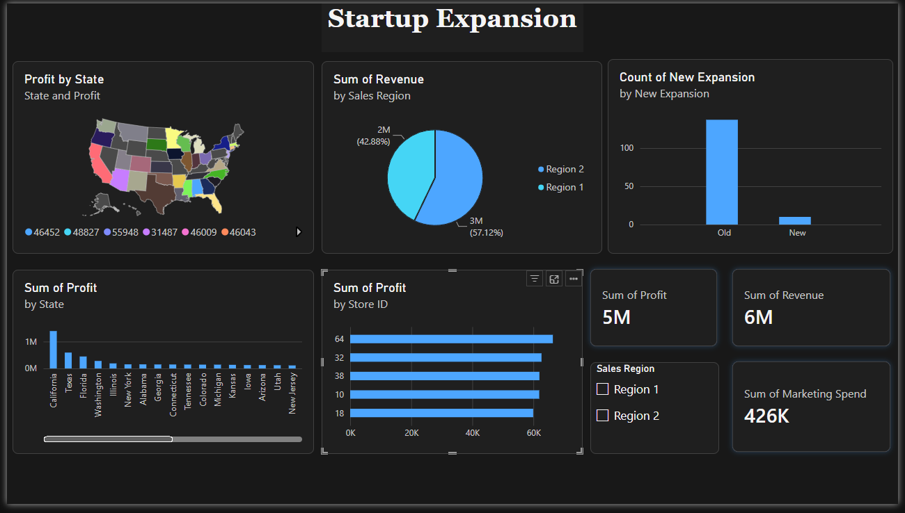

# Startup Expansion Analysis

An end-to-end data analysis project that looks at how a startup's store network performs across the United States. The data is explored and enriched with **Python** (pandas, NumPy, Matplotlib, Seaborn) in a Jupyter notebook, then presented in an interactive **Power BI** dashboard.



## Overview

The company runs 150 stores in 149 cities across 35 US states, split into two sales regions. Most are established stores ("Old"); 10 opened as part of a new expansion ("New"). The project answers questions such as:

- Which stores, states and sales regions bring in the most revenue and profit?
- Which region spends more on marketing, and does that spending pay off?
- How do the new expansion stores compare with the established ones?

## Dataset

Source file: `startup-expansion.xlsx`, one row per store.

| Column | Description |
|---|---|
| `Store ID` | Unique store identifier |
| `City` / `State` | Store location |
| `Sales Region` | `Region 1` or `Region 2` |
| `New Expansion` | `Old` (established) or `New` (expansion) store |
| `Marketing Spend` | Marketing budget spent on the store |
| `Revenue` | Revenue the store generated |
| `Profit` | *Derived:* `Revenue - Marketing Spend` |
| `ROMS` | *Derived:* return on marketing spend, `Profit / Marketing Spend * 100` |

The notebook adds `Profit` and `ROMS` and exports the result to `startup_expansion_modified.csv`, which feeds the Power BI report.

## Project structure

```
├── startup-expansion.xlsx           # Raw dataset
├── startup_expansion_eda.ipynb      # Data cleaning, EDA and business questions
├── startup_expansion_modified.csv   # Cleaned data with Profit and ROMS columns
├── Startup_Expansion_Analysis.pbix  # Power BI dashboard
├── images/dashboard.png             # Dashboard screenshot
└── requirements.txt                 # Python dependencies
```

## Analysis workflow

1. **Data inspection**: data types, summary statistics, missing values and duplicates (none found).
2. **Exploratory analysis**: marketing spend per region, unique states and cities, old vs. new stores.
3. **Business questions**: top 10 stores by revenue, revenue by region and state, revenue and marketing spend for new vs. old stores.
4. **Feature engineering**: `Profit` and `ROMS` columns.
5. **Export**: cleaned data saved to CSV for Power BI.

## Dashboard

The Power BI report (`Startup_Expansion_Analysis.pbix`) contains:

- **KPI cards**: total profit (~5M), total revenue (~6M), total marketing spend (~426K)
- **Profit by State** on a filled map
- **Revenue by Sales Region**: Region 2 brings in ~57%, Region 1 ~43%
- **Count of stores** by expansion type (Old vs. New)
- **Profit by State** bar chart: California, Texas and Florida lead
- **Profit by Store ID**: top-performing stores
- **Sales Region slicer** to filter every visual

## Getting started

### Prerequisites

- Python 3.9+
- Jupyter Notebook or JupyterLab (or VS Code with the Jupyter extension)
- [Power BI Desktop](https://powerbi.microsoft.com/desktop/) (Windows) to open the `.pbix` file

### Run the notebook

```bash
git clone https://github.com/AhmedhassanB/egyptian-startup-ecosystem-analysis.git
cd egyptian-startup-ecosystem-analysis
python -m venv venv
source venv/bin/activate      # Windows: venv\Scripts\activate
pip install -r requirements.txt
pip install jupyter
jupyter notebook startup_expansion_eda.ipynb
```

### Open the dashboard

Open `Startup_Expansion_Analysis.pbix` in Power BI Desktop. If it asks for the data source, point it to `startup_expansion_modified.csv` in your local copy (**Transform data → Data source settings → Change Source**).

## Contributing

Contributions are welcome, whether that's new analysis, better visuals, or fixes.

1. **Fork** the repository and clone your fork.
2. **Create a branch** for your change:
   ```bash
   git checkout -b feature/your-feature-name
   ```
3. **Make your changes.**
   - Notebook: keep cells in order and run *Restart & Run All* before committing so outputs match the code.
   - New Python packages go in `requirements.txt`.
   - Dashboard: describe what you changed in the PR and update `images/dashboard.png` if the layout changed.
   - Never commit secrets; `.env` is git-ignored.
4. **Commit** with a clear message:
   ```bash
   git commit -m "Add ROMS comparison by region"
   ```
5. **Push** and open a **Pull Request** against `main` explaining what you changed and why.

### Ideas for contributions

- Visualize the analysis in the notebook (Matplotlib/Seaborn charts)
- Compare ROMS between new and old stores, and between regions
- Add a city-level drill-down or a ROMS page to the dashboard
- Move the notebook logic into a reusable Python script

### Reporting issues

Found a bug or have a suggestion? [Open an issue](https://github.com/AhmedhassanB/egyptian-startup-ecosystem-analysis/issues) describing the problem, the steps to reproduce it, and what you expected to happen.

## Author

**Ahmed Mohamad Youssef**
